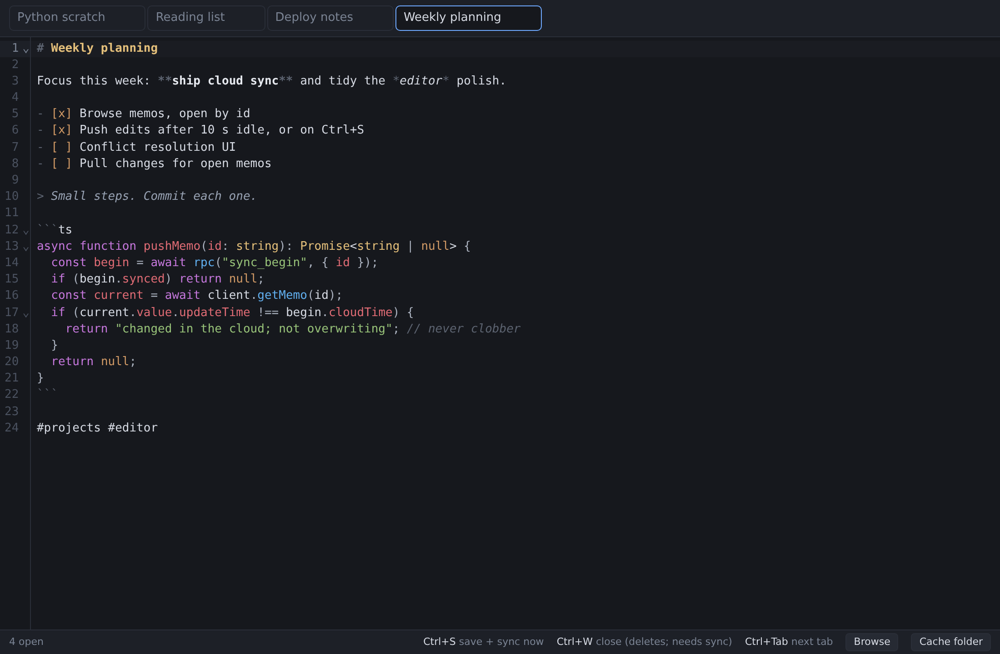
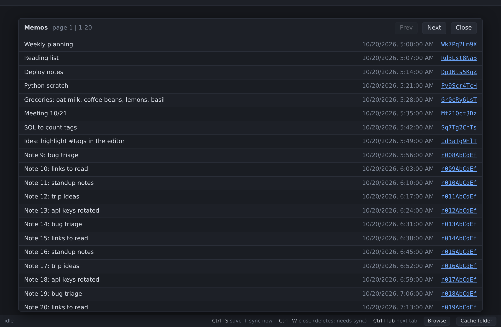
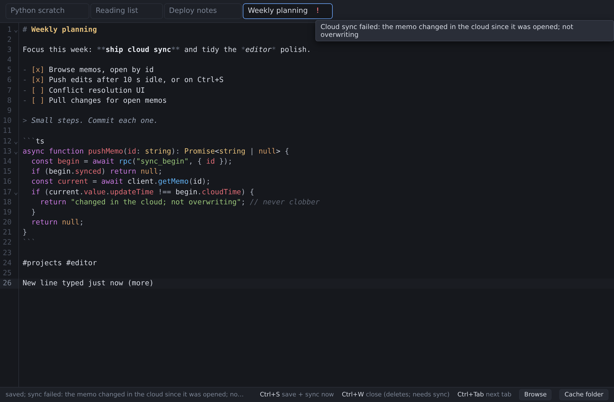

# usememos-editor-vibe

A desktop Markdown editor for [Memos](https://github.com/usememos/memos). Open
memos from your server, edit them with syntax highlighting (Markdown, and
fenced code in its own language), and the edits are pushed back. A small C host
drives a native webview (WebView2 on Windows, WebKitGTK on Linux); the UI is
CodeMirror 6; delta arithmetic is compiled by [scriptc](https://scriptc.dev).

## How it works

- **Browse** lists your memos 20 at a time; click a memo id to open it. It is
  kept locally as `memos/<memo id>.md` under the cache root, and every such
  file is a tab: a tab exists exactly as long as its file.
- **Saving.** Edits are written locally after 3 s without typing; Ctrl+S,
  switching tabs, closing and the window losing focus write at once. A `*`
  marks unsaved edits and turns red if a save is late.
- **Syncing.** A push runs 10 s after the last save, or at once on Ctrl+S. It
  fetches the memo and refuses if its `updateTime` moved since the last pull or
  push (changed in the cloud, never overwritten); otherwise it PATCHes the
  content. The tab shows `^` while waiting and a red `!` when a push failed
  (hover for the reason). Failed pushes retry when the window regains focus.
  Cloud state (the memo's `updateTime` and a hash of the text the cloud holds)
  lives in `memos/.sync/<id>`.
- **Closing** a tab deletes only the local file, and is refused until the
  document is synced.
- **Nothing polls.** When the window regains focus the host rescans `memos/`:
  new files open, deleted ones close, files changed elsewhere reload.
- **No silent failures.** Errors halt with the reason (a message box from the
  host, or the page's error screen); a startup watchdog catches a page that
  never comes up.



| Browse memos | Push refused: changed in the cloud |
|---|---|
|  |  |

More in [docs/screenshots](docs/screenshots).
## Build

```sh
./native/build.sh              # -> dist/text-edit
./native/build.sh --windows    # -> dist/text-edit-windows-x64.exe
```

The webview binaries are vendored in `native/vendor/`. The page is bundled with bun.

Linux needs WebKitGTK 6.0 at link time. Set `WEBVIEW_DEPS=skip` to link without
it and exercise the host against a stub.

Windows needs no Windows toolchain: Windows scriptc under Wine emits COFF objects
(`--emit=obj`, no linker, which is what avoids Wine's compilation-cache failure),
then host `zig cc -target x86_64-windows-gnu` links them against the prebuilt
runtime pack. `libwebview.def` generates the import library the DLL omits.

## Run

```sh
./dist/text-edit
```

No server and no URL: the page is bundled and embedded at build time, then handed
to the webview with `webview_set_html`.

Linux needs WebKitGTK; Windows needs WebView2 and `libwebview.dll` beside the
executable. `TEXT_EDIT_CACHE` selects the cache root, defaulting to
`~/.cache/text-edit`.

Required: `MEMOS_BASE_URL` (e.g. `http://host:5230`) and `MEMOS_KEY` (a Memos
access token). Startup fails with a message naming any that are missing or
empty. On Windows set them with `setx` and start from a new session. Optional:
`MEMOS_API_PREFIX` (`/api/v1` by default; `/api` for newer Memos).

## Layout

```
native/
  host.c        webview, RPC dispatch, document text, persistence
  abi.ts        delta validation and accounting (compiled by scriptc)
  profile.json  the ABI contract
  libwebview.def  import library for the Windows DLL
  build.sh      linux + windows builds
  vendor/       libwebview-x64.so, libwebview.dll (from webview-bun 2.4.0)
  ui_html.h     generated: the bundled page as a C literal
ui/
  editor.ts     CodeMirror state factories; Markdown + fenced-code highlighting
  main.ts       tabs, editor mount, rpc() client
  index.html    page shell
  panic.ts      panic / assert / run / describe
  usememos_api.ts  Memos REST client
  browser.ts    paginated memo viewer (Browse); click an id to open it
  build.ts      bundles ui/ -> native/ui_html.h
```

## Design

The webview C API is callback-driven (`webview_bind` takes a function pointer).
scriptc's `--ffi` binds only scalar and pointer signatures, so the callbacks live
in C and the arithmetic lives in compiled TypeScript. Text is owned by C; the
compiled side only decides whether a delta batch is applicable and what length it
produces.

A keystroke sends `{ranges: [{from, to, insert}], length}` rather than the
document — on a 4 KB file, 110 bytes instead of 4109. All ranges in a batch
address the **original** document, so they are sorted before arithmetic and
applied left-to-right with a moving cursor.

Every compiled export is scalar-in, scalar-out, and every `i64` return is masked
so its range is provable — scriptc rejects anything it cannot prove whole.

No throws or catches in C: expected failure returns a value, programmer error
calls `die()`. `ERR_RANGE` (frontend bug) stays distinct from `ERR_DRIFT` (stale
batch).

| | size |
|---|---|
| windows host (`.exe`, page embedded) | 4.4 MB |

## Status

Prototype. Runs on Windows. There is no WebKitGTK on the Linux dev box, so the
Linux host is only exercised against a stub webview.

## License

MIT; see [LICENSE](LICENSE). Bundled third-party components are listed in
[THIRD_PARTY_NOTICES.md](THIRD_PARTY_NOTICES.md).
